# SupplyGraph

SupplyGraph models multi-tier supply dependencies in Neo4j and explores disruption exposure and supplier alternatives.



**Status:** AnonNet and the Neo4j/GDS environment are ready. Graph loading and analysis are planned. Dependency paths indicate potential exposure, not confirmed losses.

## Start locally

```bash
uv sync
docker compose up -d
```

Open Neo4j Browser at <http://localhost:7474> (`neo4j` / `supplygraph-local-only`). Set `NEO4J_PASSWORD` to change the local password.

## Data

AnonNet CSVs are in `dataset/` locally and excluded from Git. See [dataset source and checksums](dataset/README.md) for download details and attribution.
