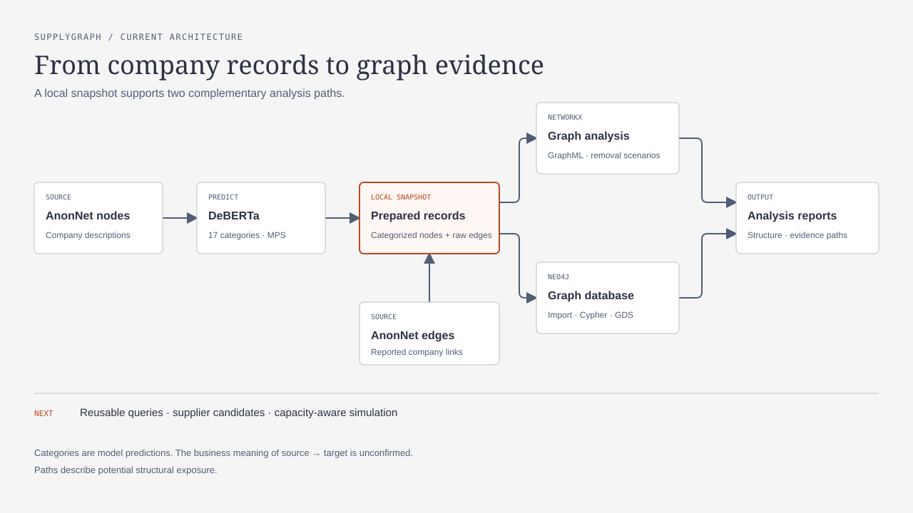

# SupplyGraph

SupplyGraph models the anonymized AnonNet company network as a knowledge graph and studies structural exposure to disruption. Neo4j stores the graph; NetworkX supports reproducible local analysis.



[Open the diagram HTML](image/supplygraph-architecture.html).

## Current status

- **Data audit:** 7,245 companies and 43,926 reported links. Schema, provenance, hashes, and data quality are in the [EDA report](reports/anonnet-eda-2026-11-04.md).
- **Product categories:** DeBERTa zero-shot assigns the project's fixed 17-category taxonomy, which is used in the current analysis. The taxonomy is project-defined, not an external product-code standard. No expert-labelled validation set is available, so describe the labels as model predictions rather than verified company capabilities.
- **Network analysis:** NetworkX graph construction, structural summaries, and node-removal experiments are implemented. See the [analysis report](reports/anonnet-heterogeneous-analysis-2026-11-04.md) and its [JSON output](reports/anonnet-heterogeneous-analysis.json).
- **Neo4j:** Snapshot import, provenance-aware Cypher examples, and baseline GDS analysis are implemented. See the [graph model and query notes](reports/neo4j-graph-model-design-2026-11-04.md) and [deep analysis](reports/neo4j-deep-analysis-2026-11-06.md).
- **Supplier alternatives and capacity-aware simulation:** Planned. The current data does not establish product compatibility, capacity, demand, lead time, or cost.

The CSV arrow `source → target` is preserved, but its supplier/customer business meaning is unconfirmed. A graph path indicates structural exposure, not proof of disruption or loss. Shared model categories are not evidence that two companies can substitute for each other.

## Setup

Install Python 3.12 and [uv](https://docs.astral.sh/uv/), then run:

```bash
uv sync --locked
```

Place `nodes_anon.csv` and `edges_anon.csv` in `dataset/`. Download links, checksums, and attribution are in [dataset/README.md](dataset/README.md). Raw data, derived files, and model weights are excluded from Git. Check the source terms before redistributing data.

## Reproduce

Audit the source CSVs:

```bash
uv run --locked python scripts/data/eda_anonnet.py
```

On an Apple Silicon Mac with MPS available, classify nonempty product descriptions. The first run downloads the pinned model; outputs are written under `dataset/derived/`.

```bash
uv run --locked python scripts/data/classify_anonnet_products.py --batch-size 16
```

Build the heterogeneous GraphML file and update the Markdown and JSON reports in `reports/`:

```bash
uv run --locked python scripts/graph/construct.py
uv run --locked python scripts/graph/analyze.py
```

Run the existing graph checks with:

```bash
uv run --locked python -m unittest discover -s tests -v
```

## Neo4j

Start the local database with `docker compose up -d`. Neo4j Browser is at <http://localhost:7474>; the default local login is `neo4j` / `supplygraph-local-only`. Set `NEO4J_PASSWORD` to use another password. The importer reads CSVs from the host and writes through the Neo4j driver; the data directory is not mounted into the container.

After generating the categorized CSV, import the snapshot with:

```bash
uv run --locked python scripts/graph/import_neo4j.py
```

The importer checks company IDs, link endpoints, and prediction details before writing. It records source rows and hashes for both CSVs and classification sidecars, and can be rerun with the same inputs. Imports created before sidecar hashes were recorded cannot be verified and require a fresh database for reimport. Run imports one at a time; snapshot replacement is not automated. Reproducible Cypher and GDS queries are in [deep_analysis.cypher](scripts/graph/deep_analysis.cypher).

## Repository layout

- `scripts/data/` — source audit and DeBERTa categorization
- `scripts/graph/` — graph construction, analysis, Neo4j import, and Cypher
- `reports/` — data, NetworkX, and Neo4j analysis outputs
- `docs/roadmap.md` — current implementation and next steps
